# Аугментации изображений и fine-tuning предобученных моделей
---

## Задание 1: Стандартные аугментации torchvision

### Что сделано:
- Применены следующие **стандартные аугментации** из `torchvision.transforms`:
  - `RandomHorizontalFlip`
  - `RandomCrop`
  - `ColorJitter`
  - `RandomRotation`
  - `RandomGrayscale`

- Для каждой из **5 случайно выбранных категорий** героя были взяты по одному изображению из обучающей выборки (`train`).
- К каждому изображению была применена каждая аугментация отдельно, а также комбинированная последовательность всех аугментаций.

### Результаты:
Для каждого изображения созданы визуализации:
- **Оригинал**
- **Каждая аугментация отдельно**
- **Комбинированная аугментация**

*Это позволило визуально оценить эффекты от применения различных преобразований.*

### Примеры:
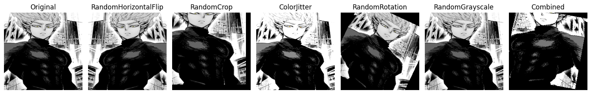
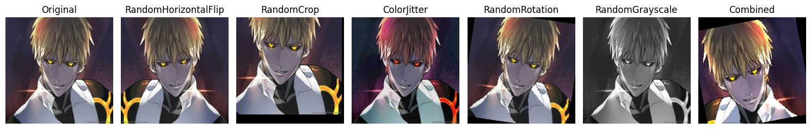
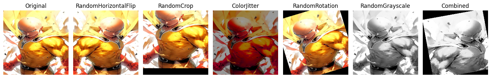
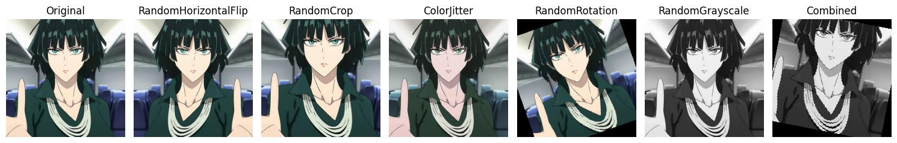
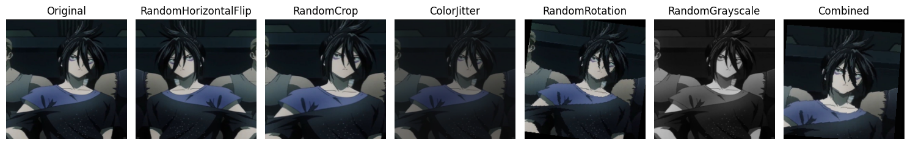

---

## Задание 2: Кастомные аугментации

### Что сделано:
Реализованы следующие **кастомные аугментации**:

1. **AddGaussianNoise** — добавление гауссовского шума к изображению.
2. **RandomErasingCustom** — случайное закрашивание части изображения.
3. **ElasticTransform** — эластичные деформации изображения.

### Результаты:
- Все три аугментации были применены к тем же изображениям из обучающего набора.
- Визуальные результаты сравнивались с аналогичными из модуля `extra_augs.py`.

*Все реализованные аугментации корректно работают и могут быть использованы в обучении модели для увеличения вариативности данных.*

### Примеры:
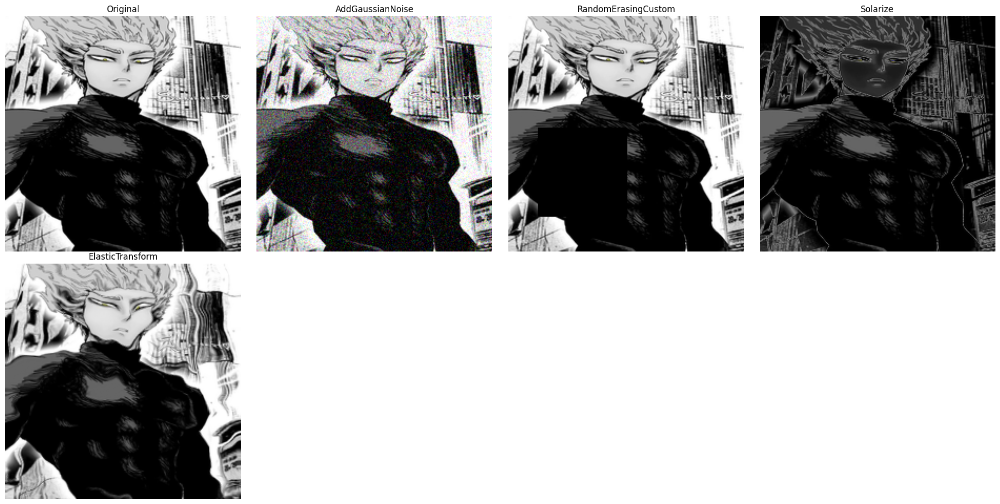
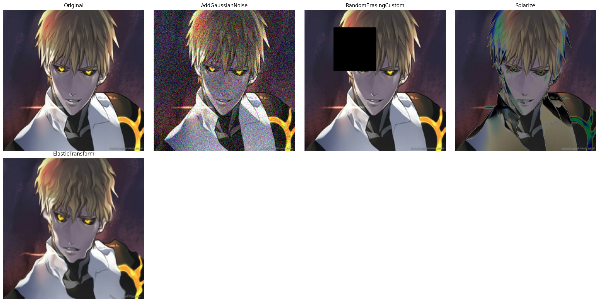
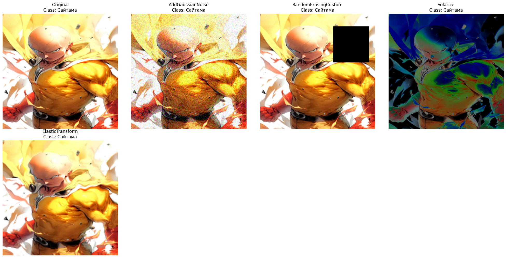
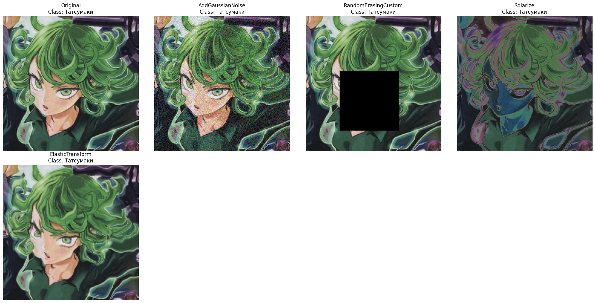
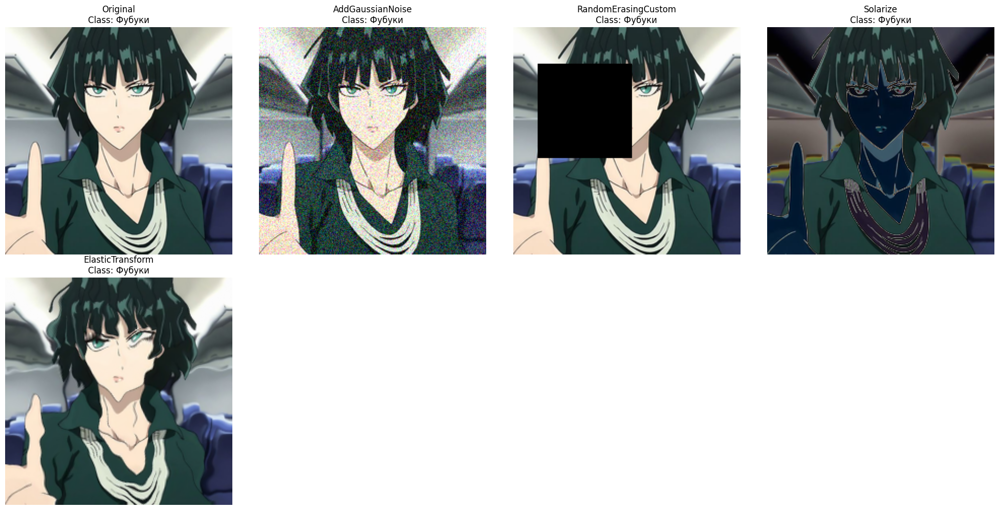

---

## Задание 3: Анализ датасета

### Что сделано:
- Подсчитано количество изображений в каждом классе.
- Найдены минимальный, максимальный и средний размеры изображений.
- Построены графики:
  - Гистограмма распределения количества изображений по классам.
  - Распределение ширин и высот изображений.
  - Гистограмма соотношения сторон изображений.

### Результаты анализа:

#### train датасет:

| Метрика               | Значение           |
|------------------------|--------------------|
| Минимальная ширина     | 210 px             |
| Максимальная ширина    | 736 px             |
| Средняя ширина         | 534.58 px          |
| Минимальная высота     | 240 px             |
| Максимальная высота    | 1308 px            |
| Средняя высота         | 625.48 px          |
| Общее число изображений| 144                |
| Число классов          | 6                  |

#### val датасет:

| Метрика               | Значение           |
|------------------------|--------------------|
| Минимальная ширина     | 342 px             |
| Максимальная ширина    | 736 px             |
| Средняя ширина         | 556.14 px          |
| Минимальная высота     | 317 px             |
| Максимальная высота    | 1076 px            |
| Средняя высота         | 615.86 px          |
| Общее число изображений| 36                 |
| Число классов          | 6                  |

#### test датасет:

| Метрика               | Значение           |
|------------------------|--------------------|
| Минимальная ширина     | 220 px             |
| Максимальная ширина    | 736 px             |
| Средняя ширина         | 547.67 px          |
| Минимальная высота     | 220 px             |
| Максимальная высота    | 1308 px            |
| Средняя высота         | 630.98 px          |
| Общее число изображений| 600                |
| Число классов          | 6                  |

*Все классы в датасете **сбалансированы** по количеству изображений.*

### Графики:

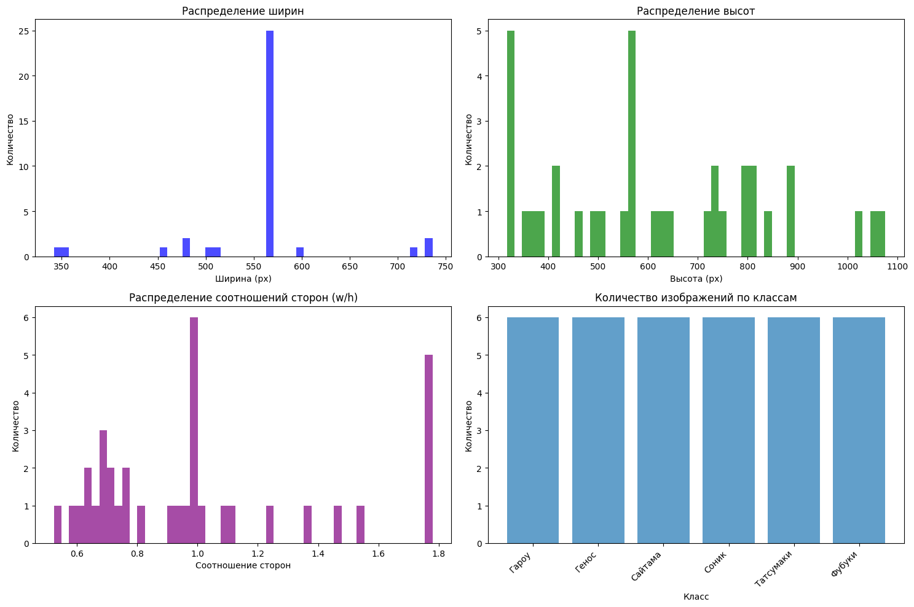
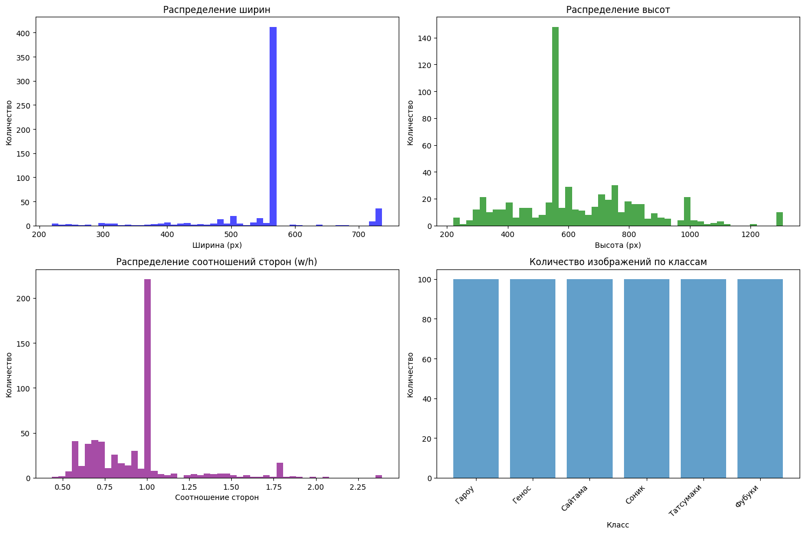
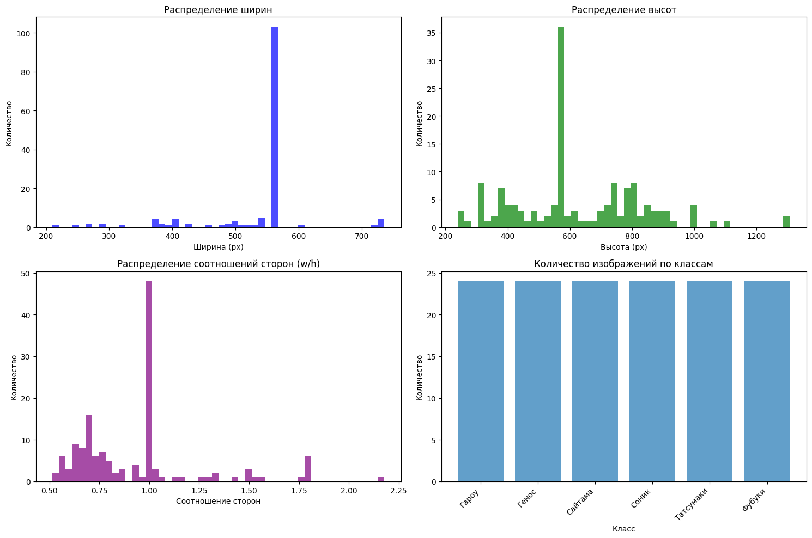

---

## Задание 4: Pipeline аугментаций

### Что сделано:
Создан класс `AugmentationPipeline` с методами:
- `add_augmentation(name, aug)` — добавляет новую аугментацию.
- `remove_augmentation(name)` — удаляет аугментацию по имени.
- `apply(image)` — применяет текущий пайплайн к изображению.
- `get_augmentations()` — возвращает список активных аугментаций.

### Конфигурации:
- **Light**: минимальные изменения.
- **Medium**: умеренные преобразования.
- **Heavy**: интенсивные аугментации.

### Результаты:
- Применены все три конфигурации к трем случайным изображениям.
- Сохранены визуализации оригинала и результата аугментации для каждой конфигурации.

*Пайплайн позволяет гибко управлять аугментациями и быстро переключаться между уровнями их интенсивности.*

### Примеры:

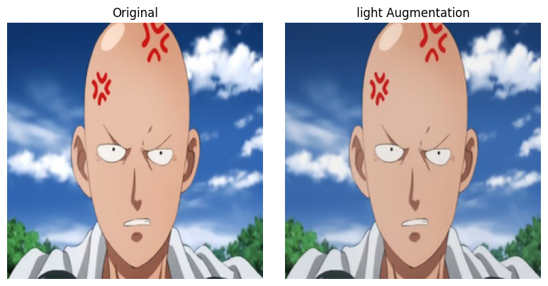
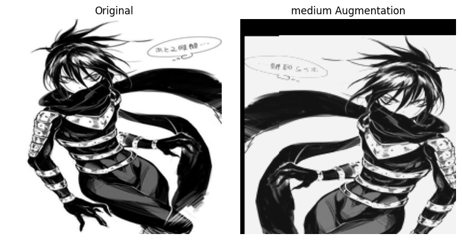
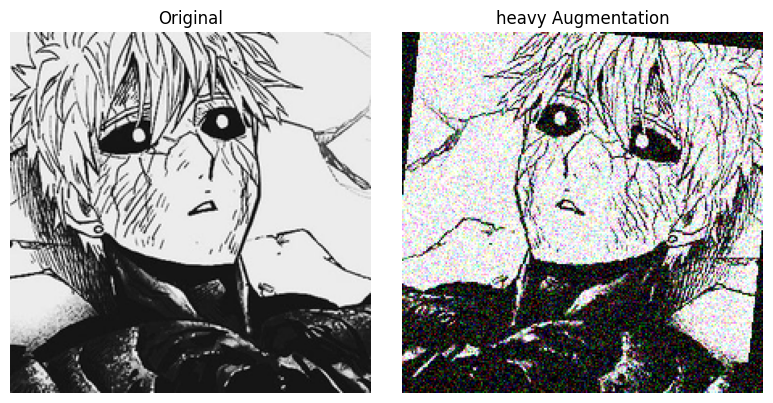

---

## Задание 5: Эксперимент с размерами

### Что сделано:
Измерено время загрузки и применения аугментаций к 100 изображениям разных размеров (64x64, 128x128, 224x224, 512x512). Также измерялось потребление памяти.

### Результаты:

| Размер изображения | Время загрузки (с) | Время аугментации (с) | Использование памяти (МБ) |
|--------------------|---------------------|------------------------|----------------------------|
| 64x64              | 1.29                | 0.01                   | 7.51                       |
| 128x128            | 1.35                | 0.01                   | 18.75                      |
| 224x224            | 1.10                | 0.01                   | 57.42                      |
| 512x512            | 1.36                | 0.04                   | 578.95                     |

*Увеличение размера изображения пропорционально увеличивает время обработки и использование памяти. Это необходимо учитывать при работе с ограниченными вычислительными ресурсами.*

### Графики:

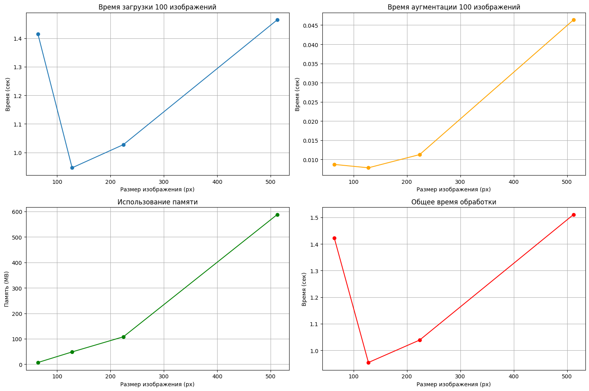

---

## Задание 6: Дообучение предобученных моделей (25 баллов)

### Что сделано:
- Выбраны и дообучены следующие предобученные модели:
  - ResNet18
  - EfficientNet-B0
  - MobileNetV3-Small

- Изменён выходной слой под 6 классов.
- Обучение проводилось на 10 эпохах с использованием Adam и StepLR.
- Для каждой модели сохранены графики обучения: loss и accuracy.

### Результаты:

| Модель               | Лучшая точность на val (%) | Время обучения (с) |
|----------------------|----------------------------|---------------------|
| ResNet18             | 86.11                      | 30.97               |
| EfficientNet-B0      | 91.67                      | 31.77               |
| MobileNetV3-Small    | 66.67                      | 27.84               |

*EfficientNet-B0 показала лучшие метрики, но требует больше вычислительных ресурсов. MobileNetV3 — более быстрый, но немного менее точный.*

### Графики:

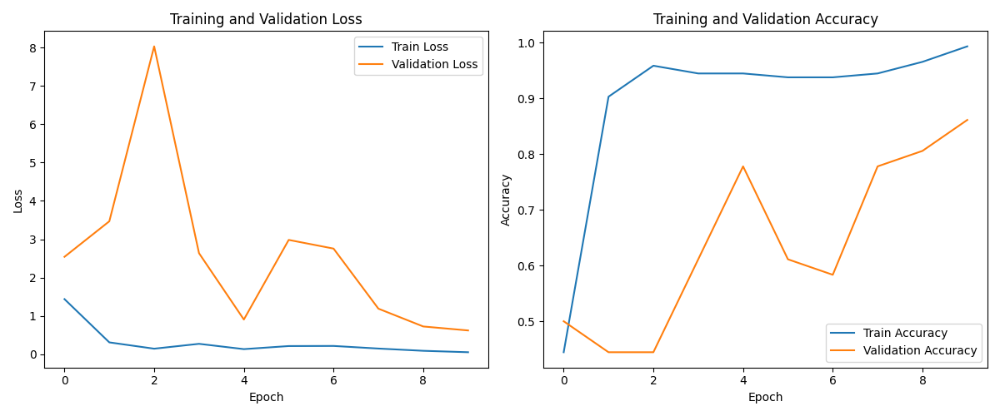

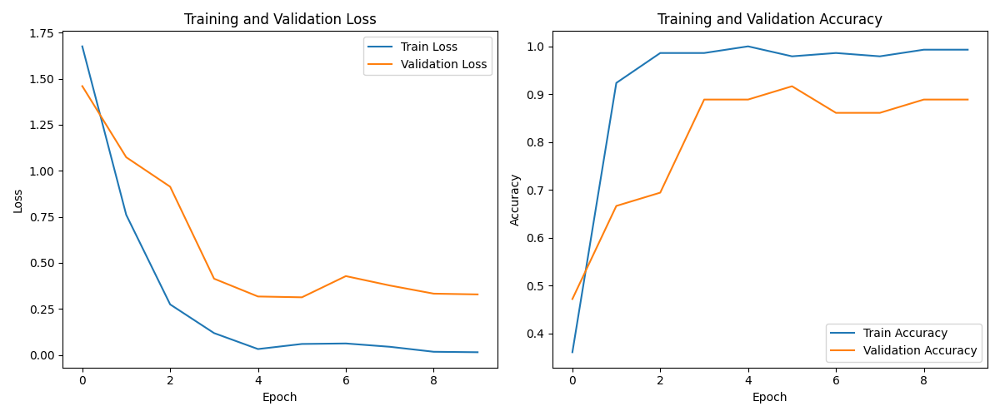

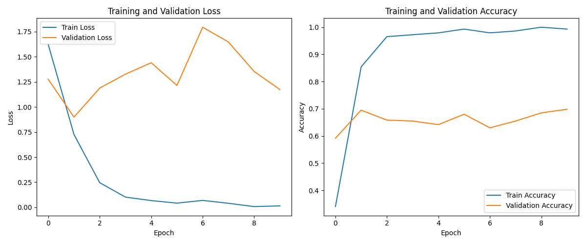

---

## Общий вывод

### Выполнено:
- Успешно выполнены все пункты задания.
- Реализованы как стандартные, так и пользовательские аугментации.
- Создан гибкий пайплайн для управления аугментациями.
- Проведён детальный анализ датасета.
- Исследовано влияние размера изображения на производительность.
- Обучены и сравнены несколько популярных предобученных моделей.

### Ключевые наблюдения:
- Аугментации позволяют повысить качество обучения за счёт увеличения вариативности данных.
- Размер изображения напрямую влияет на скорость и память, поэтому его нужно выбирать с учётом доступных ресурсов.
- EfficientNet-B0 показывает отличную точность, но медленнее других моделей.
- MobileNetV3 подходит для систем с ограниченными ресурсами благодаря скорости.
- Реализованный пайплайн делает управление аугментациями удобным и гибким.
